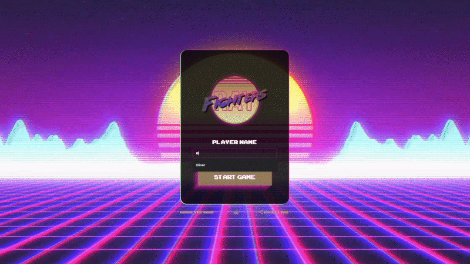

# RayFighers Web Client

The official client of the retro inspired first person shooter **RayFighters: The Game**.

## Teaser

## Quickstart Development

Make sure you have Node and NPM installed.

1. Install dependencies: `npm install`
2. start dev server: `npm run server`

The dev server will now serve the landing page. To join a game a local server instance must be running. [Instructions](https://github.zhaw.ch/raycasters/server)

Please look at the [full documentation](https://github.zhaw.ch/raycasters/docs/wiki) for the rest.

The source code documentation can be viewed [here](https://github.zhaw.ch/pages/raycasters/game/) or in the `./docs` folder. It can be generated using `npm run docs`.

### Useful links
- [Frontend documentation (the rest of the readme is here!)](https://github.zhaw.ch/raycasters/docs/wiki/Frontend)
- [Sonarqube Code Analysis](http://160.85.252.133:9000/dashboard?id=pm4-game)
- [Appveyor Build Status](https://ci.cloudlab.zhaw.ch/project/fuerbsev/game)

